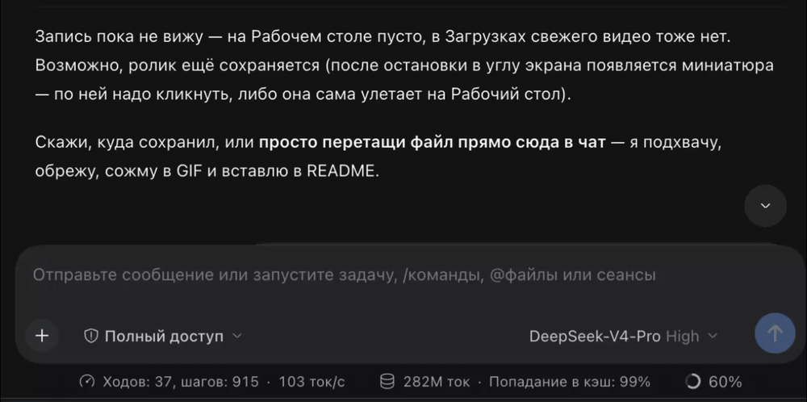

# Annotate it

Плагин для DeepSeek Harness: **разметка и ревью** прямо в чате и в документах из правой панели.

Выделил фрагмент → поставил заметку/комментарий (или быстрый ответ: да / нет / докажи / ещё / подумать) → `Enter` → всё уходит одним сообщением.

## Что умеет

- Аннотировать текст в **чате** и в **документах** (markdown, код, PDF, Office) из правой панели.
- Быстрые ответы + свой комментарий (текст или диктовка голосом).
- Два режима на каждый чат: **ожидание** (маленькая кнопка, копирование не мешает) и **рецензирование** (полная панель с полем комментария).
- Оранжевая подсветка отмеченных фрагментов, карточка с историей при наведении.
- Все заметки собираются в ленту над композером и отправляются одним сообщением, сгруппированные по документу.

## Установка

**Settings → Plugins → Add plugin** → вставь `github:walorne/dsh-annotate-it`.

## Детали

- Словарь быстрых действий редактируется прямо из панели (правый клик по чипу → изменить/удалить; «+» — добавить).
- Заметки и настройки хранятся локально (localStorage), никуда не отправляются.
- Web/Desktop DSH 0.2.x (проверено на 0.2.2-rc.3).
- Форк `dsh-quote-reply` (MIT).
